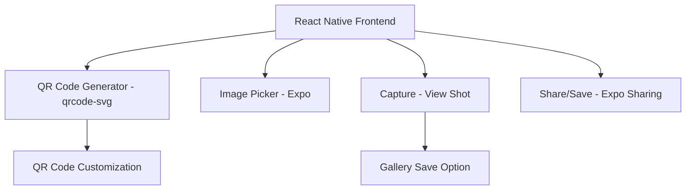

# QR Code Generator

<p align="center">
  <br/>
  A focused React Native application for generating, previewing, sharing, and saving QR codes.
</p>

## Overview

This app is now maintained as a lean Expo managed project. It keeps the QR generation flow, image capture, sharing, localization, and the UI primitives that are still actually used.

## Features

- Generate QR codes from text or URLs.
- Generate QR codes from an imported image.
- Capture a QR preview and share it.
- Save the generated code through the system share sheet.
- Switch between supported languages.

## Technology Stack

- Expo
- React Native
- Expo Router
- NativeWind
- react-native-qrcode-svg
- expo-image-picker
- expo-sharing
- react-native-view-shot

## Requirements

- Node.js LTS
- pnpm
- Git
- EAS CLI
- VS Code or Cursor

## Installation

```bash
git clone https://github.com/kteken10/reactnative_qrcode_app
cd reactnative_qrcode_app
pnpm install
```

## Development Workflow

Use `pnpm start` to launch Metro in dev-client mode.

Use `pnpm android` for a local Android development build when the Android toolchain is available.

From Windows, use `pnpm ios` to trigger an iPhone development build through Expo EAS, then install the resulting build on your device.

The repository should stay managed by Expo. Generated native folders are ignored and should not be versioned.
<h1 align="center">
  <br/>
✨ QR Code Generator ✨</h1>

<p align="center">
  <a href="https://reactnative.dev/">
    
  </a>s
  <a href="https://expo.dev/">
    
  </a>
  <a href="https://github.com/user/repo-name/blob/main/LICENSE">
    
  </a>
  
</p>

> A React Native mobile application that allows you to easily generate QR codes from different types of content.

## 📱 Overview
This application allows you to generate QR codes in a simple and intuitive way from various sources:
- 📝 Text: create a QR code from any text
- 🔗 URL: generate a QR code for a website
- 🖼️ Image: incorporate an image into your QR code
- 👤 Contact: create a QR code to share your contact details

Once the QR code is generated, you can easily share it or save it to your gallery.

## 💻 Demo
<p align="center">
  <kbd>
    <br>
    <em>Home screen with selection of QR code types</em>
  </kbd>
  &nbsp;&nbsp;&nbsp;
  <kbd>
    <br>
    <em>QR code generation interface with customization options</em>
  </kbd>
</p>

## 🚀 Features
- Intuitive and modern user interface
- Support for multiple content types
- Smooth animations for better user experience
- Import images from gallery
- Capture photos with camera
- Share and save generated QR codes

## 🛠️ Technologies Used
- [React Native](https://reactnative.dev/) - Mobile framework
- [Expo](https://expo.dev/) - React Native development platform
- [NativeWind](https://www.nativewind.dev/) - Tailwind CSS for React Native
- [React Native QR Code SVG](https://github.com/awesomejerry/react-native-qrcode-svg) - QR code generation
- [Iconsax React Native](https://github.com/huzgrx/react-native-iconsax) - Icon library
- [React Native View Shot](https://github.com/gre/react-native-view-shot) - Component screenshots
- [Expo Sharing](https://docs.expo.dev/versions/latest/sdk/sharing/) - File sharing
- [Expo Image Picker](https://docs.expo.dev/versions/latest/sdk/imagepicker/) - Image and photo selection

## 📋 Prerequisites
- [React Native development environment](https://reactnative.dev/docs/environment-setup)
- [Node.js LTS](https://nodejs.org/en/)
- [Git](https://git-scm.com/)
- [Watchman](https://facebook.github.io/watchman/docs/install#buildinstall) (for macOS or Linux only)
- [Pnpm](https://pnpm.io/installation)
- [Cursor](https://www.cursor.com/) or [VS Code](https://code.visualstudio.com/download) ⚠️ Make sure to install all recommended extensions from `.vscode/extensions.json`

## 👋 Quick Start
Clone the repository and install dependencies:

```sh
git clone https://github.com/user/repo-name
cd ./repo-name
pnpm install
```

To launch the application on iOS:
```sh
pnpm ios
```

To launch the application on Android:
```sh
pnpm android
```

## 🧩 Project Structure
The project is based on [Obytes starter](https://starter.obytes.com) and follows an organized structure:
## 🛠️ Architecture Technique




## 📦 Technologies Utilisées

| Technologie             | Utilisation                             |
| ----------------------- | --------------------------------------- |
| React Native            | Base du projet mobile                   |
| Expo                    | Outils de développement et build        |
| react-native-qrcode-svg | Génération des QR codes                 |
| Expo Image Picker       | Choix et capture d'images               |
| react-native-view-shot  | Capture d'écran de composants           |
| Expo Sharing            | Partage de fichiers                     |
| NativeWind              | Styling avec Tailwind pour React Native |
| Iconsax React Native    | Librairie d’icônes                      |

## 🚀 Installation

```bash
git https://github.com/kteken10/reactnative_qrcode_app
cd reactnative_qrcode_app
pnpm install
```

Pour lancer sur iOS :

```bash
pnpm ios
```

Pour lancer sur Android :

```bash
pnpm android
```

## 📋 Prérequis

- Node.js LTS
- pnpm
- Expo CLI
- VS Code ou Cursor
  

## 🤝 Contribution
Contributions are welcome! Feel free to open an issue or submit a pull request.

## 📄 License
This project is under [MIT](LICENSE) license.

## ✨ Credit
Developed with ❤️ using [Obytes starter](https://starter.obytes.com)
