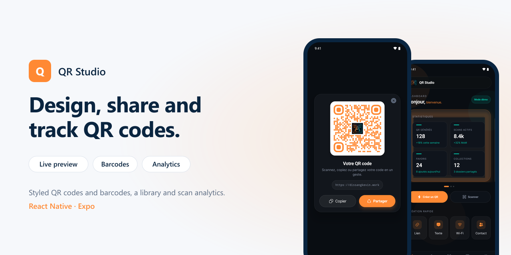
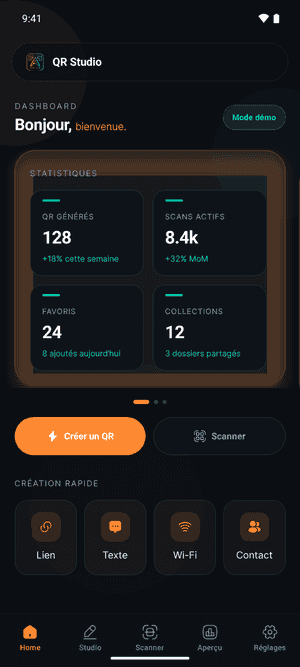
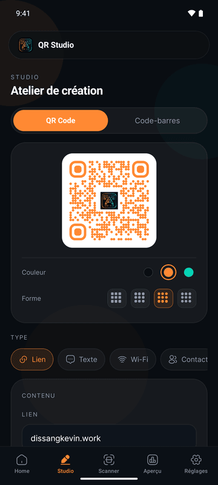
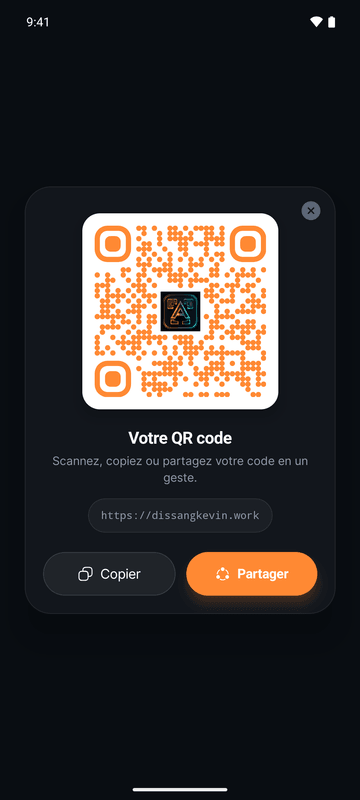
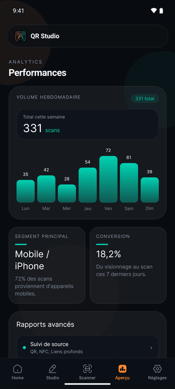
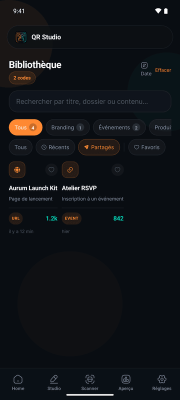
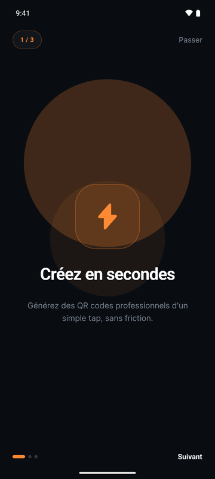

# QR Studio

<p align="center"></p>


A mobile studio to create styled QR codes and barcodes, keep them in a library and follow their scans.

## Screens

<p align="center"></p>

| Home | Studio | Your QR code |
|:---:|:---:|:---:|
|  |  |  |

| Analytics | Library | Onboarding |
|:---:|:---:|:---:|
|  |  |  |

## Features

- **Studio**: QR codes for a link, a text, a Wi-Fi network, a contact, an e-mail or a phone number, with a live preview, three colours and four module shapes.
- **Barcodes**: Code 128, EAN-13, UPC-A and Code 39.
- **Share**: the generated code opens in a card to copy its content or share it.
- **Home**: statistics, recent activity and folders in a carousel, and quick creation by type.
- **Library**: search, folder and status filters, favourites, sorting.
- **Analytics**: weekly scan volume, main device segment, conversion and reports.
- **Scanner**: decoding with the camera.
- **Onboarding** and sign-in, with a guest mode to explore the demo.

## Tech stack

- React Native 0.81, Expo 54 (New Architecture), Expo Router, TypeScript
- NativeWind, Reanimated, Gesture Handler
- [react-native-qrcode-styled](https://github.com/tokkozhin/react-native-qrcode-styled), react-native-barcode-svg, expo-camera, expo-clipboard
- Jest: QR payload builders (Wi-Fi, contact, e-mail…) are covered by tests

```
src/
├── app/            screens (Expo Router): onboarding, auth, dashboard,
│                   generator, scanner, library, analytics, settings
├── components/     premium UI kit and shared primitives
├── data/           QR types, barcode formats, demo data
└── lib/            QR payload builders, demo state, theme
```

## Getting started

```bash
pnpm install
pnpm start          # Metro, in development-client mode
pnpm android        # local Android build
pnpm test
```

The app runs on demo data: no account or backend is needed.

## Author

**Dissang Kevin** · Mobile AI Engineer
[Portfolio](https://dissangkevin.work) · [GitHub](https://github.com/kteken10)
